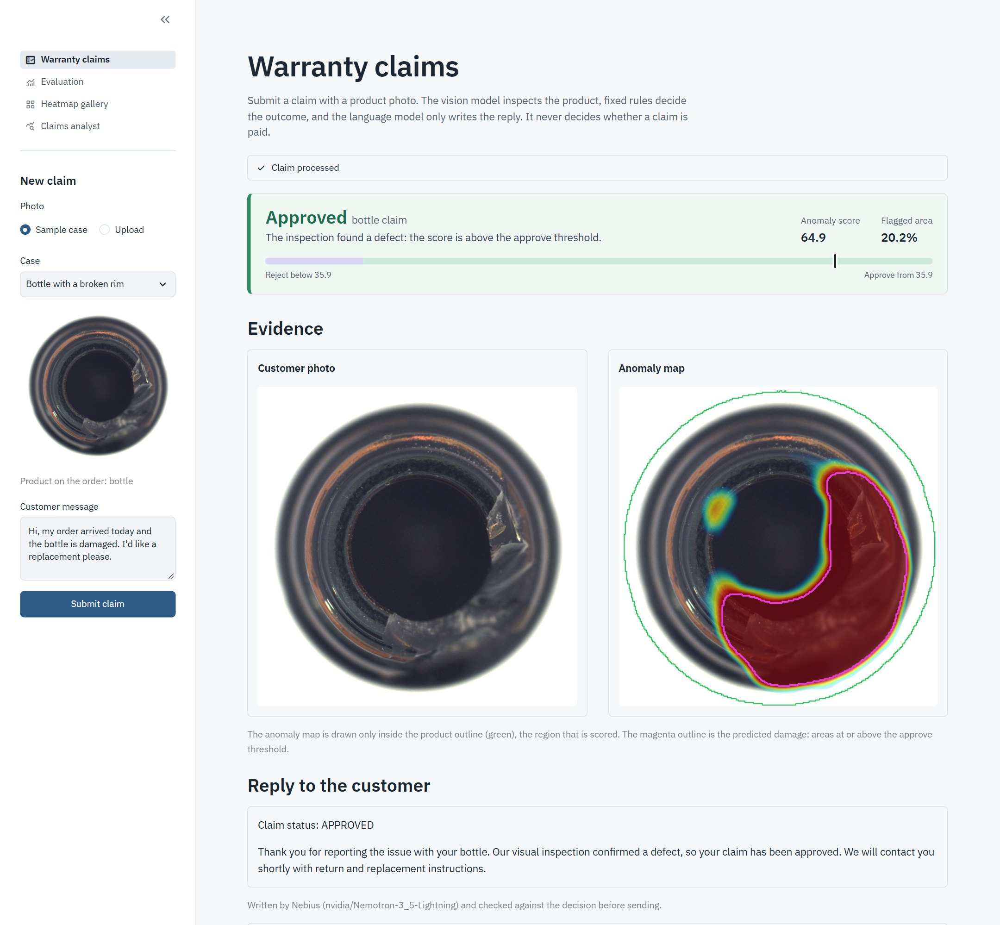
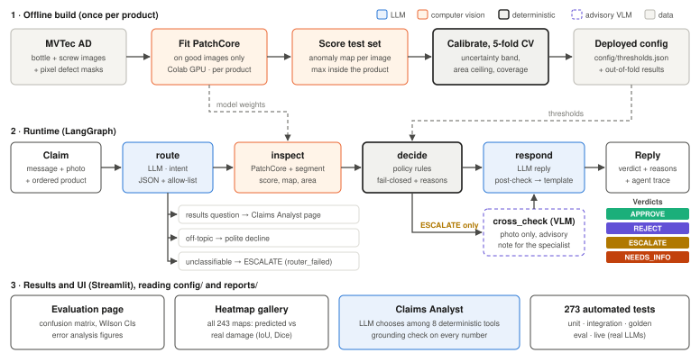
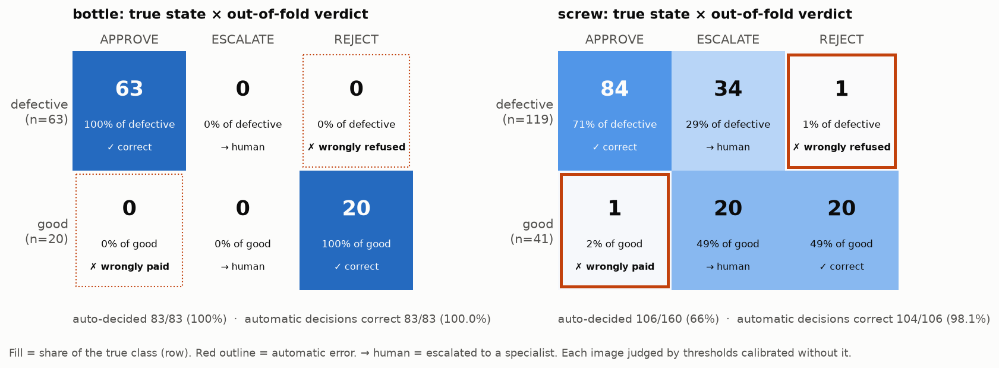
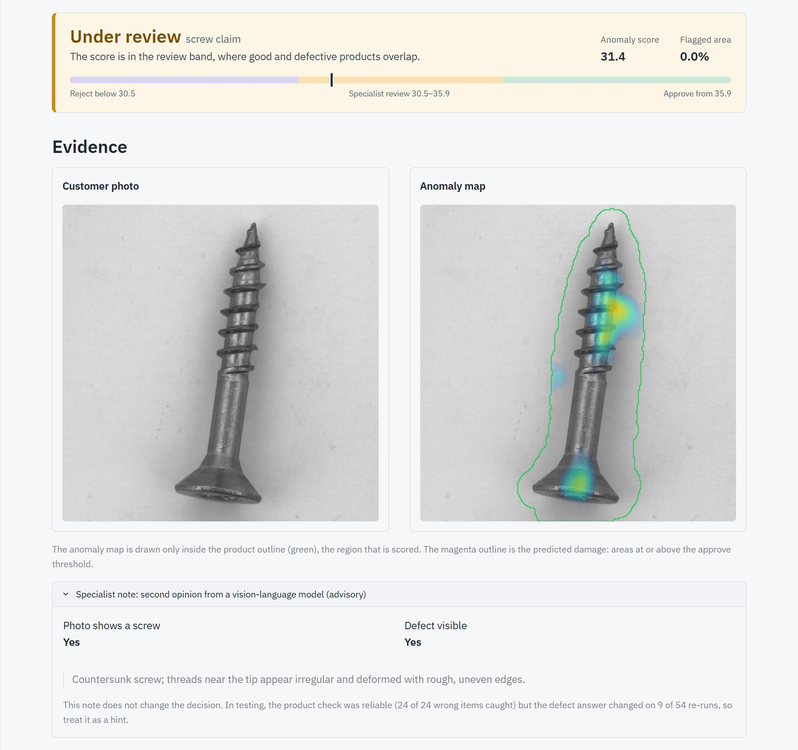
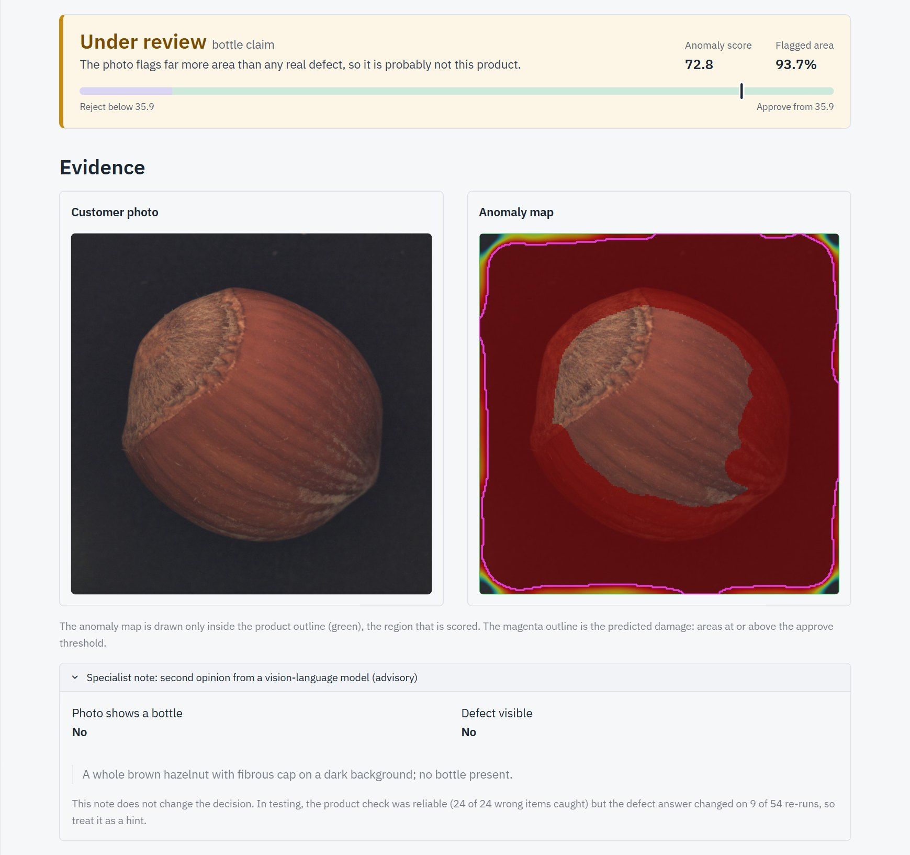
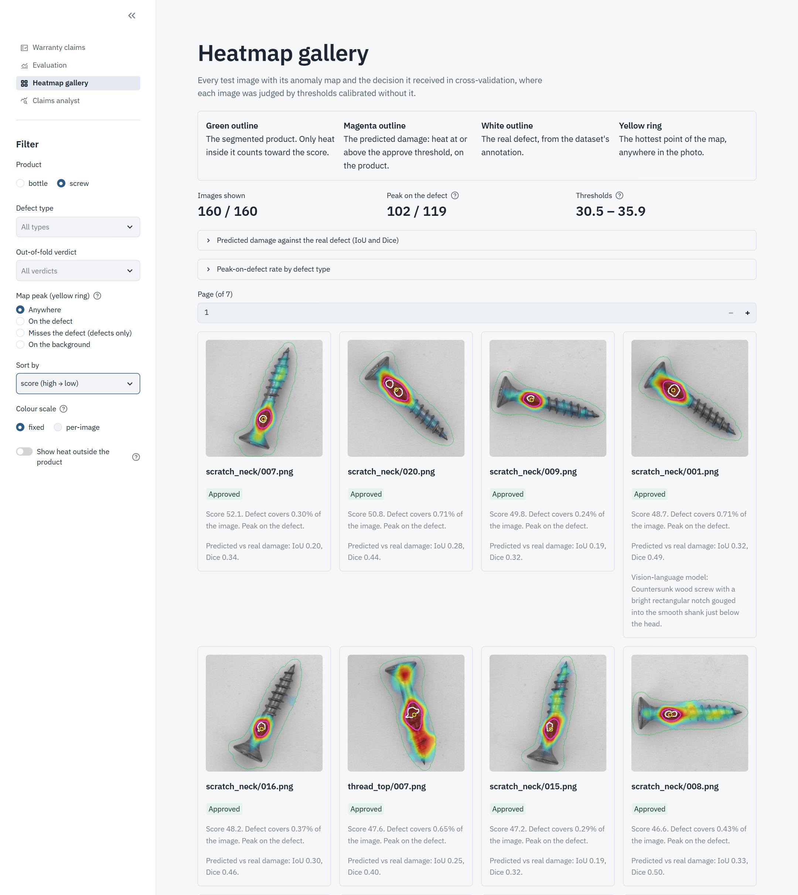
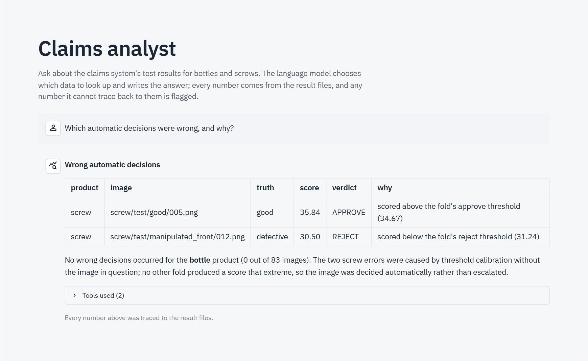

# Warranty Claims Agent

A multimodal agent that decides product warranty claims from a customer's message and a product photo.
LangGraph orchestrates an LLM intent router, a PatchCore anomaly detector, a deterministic fail-closed
policy, an LLM reply writer, and an advisory vision-language cross-check for the human specialist.

**LLMs handle language only. They never decide whether a claim is approved.**

**Demo video (9:45):** [English](https://drive.google.com/file/d/1R2tFXEqZfQdWrPGcXqeHTh0q3qANt9lZ/view?usp=sharing) ·
[Hebrew](https://drive.google.com/file/d/1bpyhgzlwQxRYJbMv4Lg39Ij-fJElj3Hq/view?usp=sharing)
&nbsp;|&nbsp; **Write-up:** [Warranty_Claims_Agent.pdf](docs/writeup/Warranty_Claims_Agent.pdf)
(executive summary, prompts and process, critical reflection, testing approach)



## Architecture



1. **Offline:** PatchCore is fitted on defect-free images only, and the decision thresholds are calibrated with stratified
   5-fold cross-validation, then deployed as `config/thresholds.json`.
2. **Runtime:** each claim runs through a LangGraph graph. LLMs classify the message and write the reply; the verdict comes
   from deterministic, fail-closed rules; the vision-language model only advises the human specialist on escalated claims.
3. **Results and UI:** the Streamlit pages and the Claims Analyst read the same deployed config and out-of-fold results.

| Component | Implementation | File |
|---|---|---|
| Router | Nemotron 3.5 Lightning, JSON output, allow-list, retry, keyword fallback | `claims/router.py` |
| Inspector | PatchCore (anomalib 2.7, WideResNet-50, 10% coreset), one model per product; scores only the segmented product | `claims/inspector.py`, `claims/segment.py`, `cv/patchcore.py` |
| Policy | Pure Python; calibrated uncertainty band; out-of-distribution area guard; product-coverage check | `claims/policy.py`, `cv/calibrate.py` |
| Responder | LLM reply; must open with a fixed status line; contradiction blocklist; template fallback | `claims/responder.py` |
| Cross-check | GLM-5.3-Flash sees the photo only, never the customer text; note for the specialist | `claims/cross_check.py` |
| Graph | LangGraph `StateGraph` with SQLite checkpointer; full agent trace | `claims/graph.py` |
| Claims Analyst | Chat agent over the evaluation results: deterministic tools compute every number; grounding check rejects numbers found in no tool result | `claims/analyst.py` |
| UI | Streamlit: Claims demo, Evaluation, Heatmap Gallery, Claims Analyst | `streamlit_app.py`, `app_pages/` |

## Results

Dataset: [MVTec AD](https://www.mvtec.com/company/research/datasets/mvtec-ad) `bottle` (83 test images) and
`screw` (160), chosen as structural opposites (see below). AUROC is on the full test set. Every threshold-dependent number is **5-fold out-of-fold**: each image was
judged by a band calibrated without it. Brackets are Wilson 95% confidence intervals.

| | bottle | screw |
|---|---|---|
| Image AUROC | 1.000 | 0.971 [0.943–0.991] |
| Pixel AUROC | 0.984 | 0.990 |
| Escalated to a human | 0% (0/83) | 33.8% (54/160) [27–41%] |
| Approve precision | 100% (63/63) [94–100%] | 98.8% (84/85) [94–100%] |
| Good product auto-approved | 0/20 [0–16%] | 1/41 [0–13%] |
| Defect auto-rejected | 0/63 [0–6%] | 1/119 [0–5%] |

For reference, the PatchCore paper (Roth et al., 2022, Tables S1/S2, 10% coreset) reports image AUROC 100 and 97.0,
and pixel AUROC 98.6 and 99.4, for bottle and screw respectively.



Adversarial golden cases: 26 of 26 wrong-object photos (cable, hazelnut, metal nut, toothbrush, and cross-product) are
escalated; with the out-of-distribution guard removed, all 26 are auto-approved.

VLM cross-check on the 54 real escalations: it saw 30 of 34 real defects and falsely flagged 4 of 20 good screws. But re-running the
identical calls changed its defect answer on 9 of 54, even at temperature 0. Its product check is stable and caught 24 of 24
wrong-object photos with 0 of 74 false alarms. It stays advisory.

Does the heatmap point at the defect? The anomaly map's hottest pixel lands on the ground-truth defect in 63/63 bottle
and 102/119 screw defects. 8 of the 88 approved screws were approved with the peak elsewhere (right verdict, possibly
wrong reason). Browse all 243 maps on the **Heatmap Gallery** page.

Localisation: the predicted damage mask (heat at or above the approve threshold, inside the product; magenta in the app)
against the annotation reaches a median IoU of 0.54 on bottle defects but only 0.18 on screws (41 of 119 screw masks are empty,
including every claim sent for review). Pixel AUROC (0.99) hides this. `python -m cv.localization` writes the per-image numbers.

Heat outside the screw turned out to be real lint and dust on the backdrop, mostly in the defect photos, and it approved 4
claims for the wrong reason. **The claim score is therefore the anomaly map's maximum inside the segmented product**
(`claims/segment.py`). An implausible cut-out escalates (`segmentation_failed`), and the wrong-object guard still measures the
whole photo. Cost: 54 instead of 47 screw escalations; approve precision and error counts are unchanged. Diagnosis:
`python -m cv.heat_zones screw`.

Error and dataset analysis (`reports/figures/`): screw escalations are driven by **defect size** (escalated defects
are smaller, Mann-Whitney p=0.0001). **Orientation** is ruled out. **Lighting** is a real dataset confound (every good
test screw is darker than every defective one) but a relighting experiment shows it does not cause the escalations.

### Screenshots

| | |
|---|---|
|  |  |
| **Uncertain claim:** the score falls in the review band, so it goes to a specialist with an advisory note. | **Attack, wrong item:** 93.7% of the photo is flagged, so the wrong-object guard escalates it instead of paying. |
|  |  |
| **Heatmap gallery:** predicted damage (magenta) against the real defect (white). | **Claims Analyst:** deterministic tools compute every number; a grounding check verifies the answer. |

### Why bottle and screw

The two categories were chosen deliberately as opposite cases, not as a sample of the benchmark:

- **bottle**: a rigid body with a smooth, uniform surface and large, visible defects. The classes separate perfectly on
  anomaly score, so this is where automation should be fully confident (0% escalated).
- **screw**: a small metallic object in arbitrary rotation, with fine structure and small, high-frequency thread defects.
  The classes overlap, so this is the case that exercises escalation, calibration and error analysis. Rotation turned out not
  to explain the errors; defect size does.

Two categories also kept the full loop (fit, cross-validated calibration, error analysis, golden tests) within the
project deadline and on a CPU-only laptop.

## Future work and scaling to the full benchmark

The agents are category-agnostic. The router, inspector, policy, responder, cross-check and graph contain no product
names: they read the supported products from `config/thresholds.json`, and the UI's product list is built from it. Adding a
product means fitting one PatchCore model and calibrating its band. The immediate next phase is scaling the empirical evaluation
across all 15 MVTec AD categories and the VisA dataset, specifically to benchmark the stability of the **defect-area
ceiling** (the out-of-distribution guard, `Band.max_area`) across diverse product classes (e.g., textiles, electronic
components, and organic materials). Its 1.5× margin and 10% floor were set from two products. In texture categories the product
fills the frame and real defects can be large, so the gap to wrong-object photos may shrink.

Other next steps: a higher-resolution screw model (small defects drive escalations), a safety margin around the band,
a calibration set of real customer photos, and a per-category VLM evaluation.

Longer term: fine-tuned AI models in the final decision itself, alongside the deterministic rules, to decide more cases
automatically across a wider variety of products. A model would get that role only after passing the same evaluation
(cross-validated metrics, adversarial golden set, repeated live runs), with the rules kept as guardrails.

## Quick start

Developed and tested on Python 3.13 (Windows, CPU). PatchCore fitting runs on a GPU in Colab.

```bash
python -m venv .venv
.venv\Scripts\activate             # Linux/macOS: source .venv/bin/activate
pip install -r requirements.txt -r requirements-dev.txt
```

Create `.env` with a [Nebius Token Factory](https://tokenfactory.nebius.com/) key (`OPENAI_API_KEY` works as a
text-only fallback; the cross-check requires Nebius):

```
NEBIUS_API_KEY=...
# optional overrides
# NEBIUS_MODEL=nvidia/Nemotron-3_5-Lightning
# NEBIUS_VLM_MODEL=zai-org/GLM-5.3-Flash
```

Data and models:

```bash
python -m cv.download_mvtec --foreign      # MVTec bottle + screw, plus 12 held-out foreign-object photos
# Fit PatchCore: open cv/fit_patchcore.ipynb in Colab (T4), run all, unzip the result:
#   models/<category>/weights/torch/model.pt   and   reports/raw/scores.csv, maps_*.npz
python -m cv.evaluate                      # folds, deployed thresholds, out-of-fold metrics
```

Run the app:

```bash
streamlit run streamlit_app.py             # http://localhost:8501 — first claim loads models (~30 s)
```

The Claims page has eight sample cases: three for bottle, three for screw, a hazelnut photo submitted for a bottle
claim, and a prompt-injection message.

Regenerate the analysis (optional):

```bash
python -m cv.analyze_dataset               # reports/dataset_features.csv
python -m cv.error_analysis                # reports/figures/01-06
python -m cv.vlm_eval                      # reports/vlm_metrics.json (~90 live VLM calls, a few cents)
```

## Tests

273 tests in five layers. The default `pytest` run is the fast layer.

| Layer | Command | Count | What it covers |
|---|---|---|---|
| unit | `pytest` | 177 | policy boundaries, calibration, folds, metrics, router/responder/cross-check parsing and fallbacks, every UI page renders |
| integration | `pytest` | 18 | full LangGraph runs with a fake inspector and stub LLMs: every route, every fail-closed path |
| golden | `pytest -m golden` | 61 | real PatchCore + deployed thresholds on real images: labelled, wrong-object, injection, broken input |
| eval | `pytest -m eval` | 4 | fit→export→load smoke test, fit inside a Jupyter kernel, CPU/GPU score parity |
| live | `pytest -m live` | 13 | real LLM: responder never attributes customer details to the inspection; Claims Analyst answers are grounded and factually right; prompt injection cannot change a verdict |

Safety-critical tests were checked by mutation: each deliberately introduced fault (for example, letting the VLM approve, removing the
area guard, dropping the `isfinite` check) makes at least one test fail.

## Repository layout

```
claims/            agents, policy and graph (runtime)
cv/                data download, PatchCore fit/score, calibration, evaluation, analysis, Colab notebook builder
app_pages/         Streamlit pages; streamlit_app.py is the entry point
config/            deployed thresholds (generated by cv.evaluate)
reports/           metrics, out-of-fold verdicts, figures, VLM eval
tests/             unit, integration, golden, eval, live
docs/              design doc, development log, legacy README, architecture diagram, write-up (writeup/ PDF + source)
demo_recording/    demo video scripts: subtitles (English, Hebrew), subtitle burn-in, AI narration, teleprompter
agent/             LLM factory + the original text-only Bitext analyst (no longer in the UI; see docs/legacy-dataset-analyst.md)
```

`docs/dev-log.md` records every real bug, wrong AI output and verification step in the order they happened.
`docs/plans/2026-10-14-warranty-claims-design.md` holds the design and the alternatives that were rejected.
The original Bitext dataset-analyst agent is documented in `docs/legacy-dataset-analyst.md`.

## Known limitations

- MVTec images are studio photos. Real phone photos (other angles, lighting, backgrounds) are the largest untested gap.
- Thresholds are set by the single most extreme good and defective images, so the band is brittle at its edges.
  Both out-of-fold screw errors are exactly those images.
- The bottle band has zero width (perfect separation on 83 images), so no bottle claim is ever escalated.
- Product segmentation assumes a dark product on a light backdrop (true for MVTec). A hazelnut photo with a dark background was
  "segmented" as nearly the whole frame. The whole-photo wrong-object guard caught it, but cluttered real photos are untested.
- Fraud (reused or stock photos) is out of scope.

## License

MVTec AD is licensed CC BY-NC-SA 4.0 (non-commercial use only).
